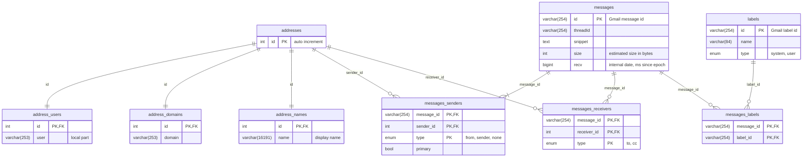

# Gmail Sync Tool

> [!NOTE]
> Google keeps tightening the Gmail API limits. Since May 2026 new projects
> get 6,000 quota units per user per minute and `messages.get` costs 20
> units, so a sync cannot exceed about 300 messages per minute (see
> [Usage limits][quota]). `gmailsync.py` paces its requests to 5,000 units
> per minute (about 250 messages) and retries rate limited or failed
> requests with exponential backoff, so a large mailbox takes hours but
> should complete in a single run. An interrupted sync resumes where it
> stopped.

[quota]: https://developers.google.com/workspace/gmail/api/reference/quota

This tool synchronizes Gmail metadata into a MariaDB/InnoDB database to allow
further analysis.

Documentation is yet to be written, most of it is inline in `gmailsync.py` at
the moment.

## Setup

1. Create a virtualenv and add install requirements. This requires Python
   3.11 or later, and the `mariadb` module needs the Python headers and
   MariaDB Connector/C to build (`python3-dev` and `libmariadb-dev` on
   Debian/Ubuntu).

   ```sh
   python -mvenv venv
   echo '*' >venv/.gitignore
   . venv/bin/activate
   pip install -U pip setuptools
   pip install -r requirements.txt
   ```

2. Create a database, ex:

   ```sql
   CREATE DATABASE `gmail` DEFAULT CHARACTER SET utf8mb4 COLLATE utf8mb4_general_ci;
   GRANT USAGE ON *.* TO `gsync`@`%` IDENTIFIED BY '<PASSWORD>';
   GRANT ALL PRIVILEGES ON `gmail`.* TO `gsync`@`%`;
   ```

3. Copy `config.toml.example` to `config.toml` and set the database URL

4. Create an OAuth client in the [Google Cloud Console][console]:

   1. Create a project and enable the Gmail API for it.
   2. Configure the OAuth consent screen (Google Auth Platform) with the
      External audience, leave the app in Testing status and add your Gmail
      account as a test user. The app is meant for personal use and never
      needs to be published or verified.
   3. Create an OAuth client ID of type "Desktop app" and download its JSON
      file right away: the client secret is only shown at creation (a new
      one can be added later if it is lost). Note that Google deletes
      clients unused for six months.
   4. Save the file as `gmailsync_client.json` next to `gmailsync.py`,
      readable only by you (`chmod 600 gmailsync_client.json`).

5. Run `./gmailsync.py`, open the printed link, authorize the app and paste
   the authorization code at the prompt.

   The access token is then saved to `gmailsync_token.sh`; run
   `. gmailsync_token.sh` to skip authentication on later runs until it
   expires, after one hour. This token cannot be refreshed, so authenticate
   interactively for syncs that may run longer.

[console]: https://console.cloud.google.com/

## Database schema

Tables are created by `gmailsync.py` on the first run. An address is a unique
(user, domain, display name) tuple, matched through the database collation
(case and accent insensitive). Each message has exactly one primary sender:
the single `From:` address, else the single `Sender:` address, else a
placeholder (type `none`).



## Sample queries

Sample report queries...

### Top 100 senders by count

```sql
SELECT
    COUNT(m.id) AS Count,
    CONCAT(au.user, '@', ad.domain) AS `Sender Email`
FROM messages m
    INNER JOIN messages_labels ml ON m.id = ml.message_id
    INNER JOIN messages_senders ms ON m.id = ms.message_id
    INNER JOIN addresses a ON ms.sender_id = a.id
    INNER JOIN address_users au ON a.id = au.id
    INNER JOIN address_domains ad ON a.id = ad.id
WHERE ml.label_id = 'INBOX'
GROUP BY a.id
ORDER BY Count DESC
LIMIT 100;
```

### Top 100 senders by size

```sql
SELECT
    SUM(m.size)/1024/1024 AS `Size (MB)`,
    COUNT(m.id) AS Count,
    CONCAT(au.user, '@', ad.domain) AS `Sender Email`
FROM messages m
    INNER JOIN messages_labels ml ON m.id = ml.message_id
    INNER JOIN messages_senders ms ON m.id = ms.message_id
    INNER JOIN addresses a ON ms.sender_id = a.id
    INNER JOIN address_users au ON a.id = au.id
    INNER JOIN address_domains ad ON a.id = ad.id
WHERE ml.label_id = 'INBOX'
GROUP BY a.id
ORDER BY `Size (MB)` DESC
LIMIT 100;
```
